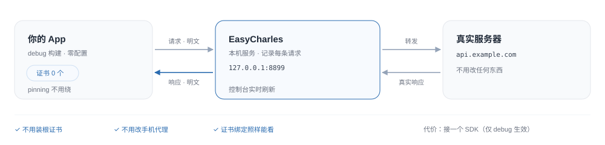
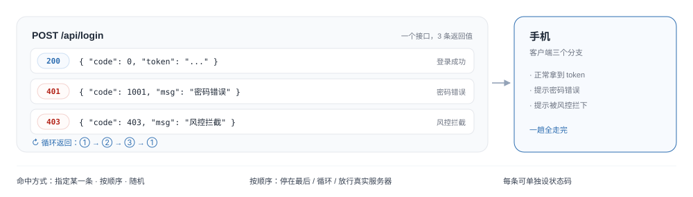
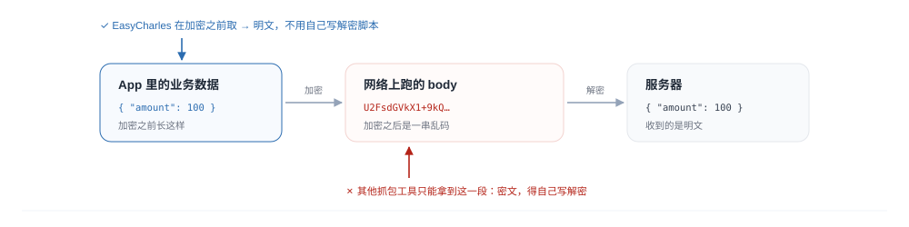
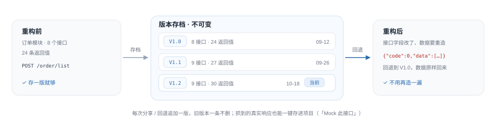
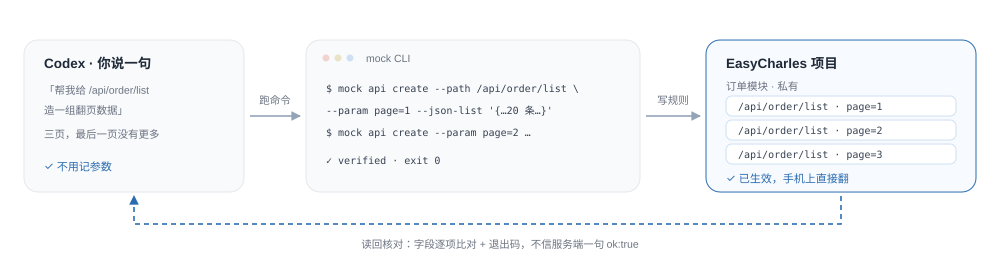

# EasyCharles

**客户端接口联调工具。不用装证书，改返回值不用等后端，调好的配置能沉淀成模板。**


## 能干什么

### 1. 抓包，手机不用装证书



### 2. 改返回值，一个接口可以配好几条



### 3. 加密接口也能看



### 4. 调好的配置能存下来、发给同事


### 5. 接口返回值按版本存档



### 6. 接进 AI 工作流



> 这六条各自怎么用、参数怎么填、容易踩什么坑：[docs/guide.md 第 6 节](docs/guide.md#6-逐条详解)。

## 三步用起来

**1. 部署到局域网那台 Mac**（需要 Node 22.6+）

```bash
bash scripts/deploy.sh          # 门禁 → 打包 → 推送 → 重启 → 验收，一条命令
```

目标机写在 `scripts/deploy.conf` 的 `EC_DEPLOY_TARGET`（本机不进 git，模板见 `.example`）。
部署完打开 `http://<那台 Mac 的内网 IP>:8899`，手机号 + 口令（首次登录即注册）。

日常运维也走这一个入口：`bash scripts/deploy.sh status`（远端在跑哪版）、`logs`（看日志）、
`rollback`（回上一个版本）。

> 本机不再作为服务端：这台机器只负责开发和构建。想先在本机看一眼，用 `cd server && npm start`
> ——它只监听 `127.0.0.1`，是开发预览，不是部署形态。

**2. App 接入**

```kotlin
// build.gradle.kts：只在 debug 构建引入
debugImplementation(project(":easy-charles"))
```

```kotlin
// Application.onCreate
EasyCharles.init(this, EasyCharles.Config(baseUrl = "http://<那台 Mac 的内网 IP>:8899"))

// OkHttp：放在最外层（这一步决定加密接口能不能看到明文）
val client = OkHttpClient.Builder()
    .addInterceptor(EasyCharlesInterceptor())   // ← 最外层
    .addInterceptor(yourCryptoInterceptor)      // ← 业务的加解密拦截器
    .build()
```

**3. 手机连过来**

手机和那台 Mac 连**同一个 Wi-Fi**，`baseUrl` 填上面的内网地址即可，不用任何端口转发。

> Android 9+ 默认禁明文，要给 debug sourceSet 加 `network_security_config.xml`（写法见详细版）。
> 也别用 `adb reverse`：它只对插着 USB 的那台机器生效，连不到局域网里的另一台 Mac。

## 操作面板

浏览器打开 `http://<那台 Mac 的内网 IP>:8899`，手机号 + 口令登录（首次登录即注册）。
顶栏左边切模式，中间选设备（点未绑定的设备就是绑定），右边是连接状态、当前空间和「关于」。

| 模式 | 面板长什么样 | 常用动作 |
| --- | --- | --- |
| 浏览 | 左边记录列表（按 URL / 状态码搜索）+ 右边详情 | 看参数、头、body；详情底部「Mock 此接口」「分享快照」「复制为 cURL」 |
| Mock | 顶部可横滑的项目卡片栏 + 左接口列表 + 右返回值编辑器 | 加删返回值、改状态码、选命中方式、整组启停 |
| 模板 | 私有 / 共享两个 tab，网格卡片 | 分享、复制到我的项目、历史版本、回退、归档、删除 / 恢复 |

**详情面板**是主战场：状态码、总耗时与上游耗时、query 参数表（能看哪几项参与了匹配）、
请求头 / 响应头、请求 body 与响应 body。body 有层级树和 JSON 文本两种看法，可放大、格式化、复制；
解密过的记录会打「已解密」标，响应体上能直接切「查看密文」。

**另外两个页面**：`/crypto` 加解密配置（算法 / Key / IV / 密文位置，也可以挂一段脚本），
`/admin` 管理员视图（启动时配了 `--admin` 才有）。分享出去的快照是 `/s/<id>`，免登录只读。

一次典型调试：手机发一条请求 → 浏览模式点开对参数 → 「Mock 此接口」 → 在 Mock 模式加两条
（成功 / 401）→ 手机上重新进页面看效果 → 调好分享成模板。

## 几件要知道的事

- 只在 **debug 构建**生效，release 包里没有任何代码
- 抓包记录存在内存里（默认 2000 条），**重启服务就丢**
- 服务跑在那台 Mac 上（启动带 `--lan`），同网段任何人都能借它转发，**只在可信网络开着**
- 项目历史版本会长期保留后来删掉的返回 body（可能有 token / cookie），共享前先自查

## 详细说明

| 想了解 | 去哪 |
| --- | --- |
| 部署（一条命令 / 手动 / 回滚 / 数据目录） | [guide.md 第 2 节](docs/guide.md#2-部署) |
| 接入 Android 与手机连接 | [guide.md 第 3、4 节](docs/guide.md#3-接入-android) |
| 操作面板逐个区域 | [guide.md 第 5 节](docs/guide.md#5-操作面板) |
| 六条能力的详细用法 | [guide.md 第 6 节](docs/guide.md#6-逐条详解) |
| 原理、分层、数据流 | [architecture.md](docs/architecture.md) |
| 协议与字段定义 | [protocol.md](docs/protocol.md) |
| 加解密配置字段 | [crypto.md](docs/crypto.md) / [crypto-plugin.md](docs/crypto-plugin.md) |
| mock CLI 完整约定 | [mock-cli.md](docs/mock-cli.md) |
| 部署到内网服务器（systemd / launchd） | [scripts/deploy/DEPLOY.md](scripts/deploy/DEPLOY.md) |
