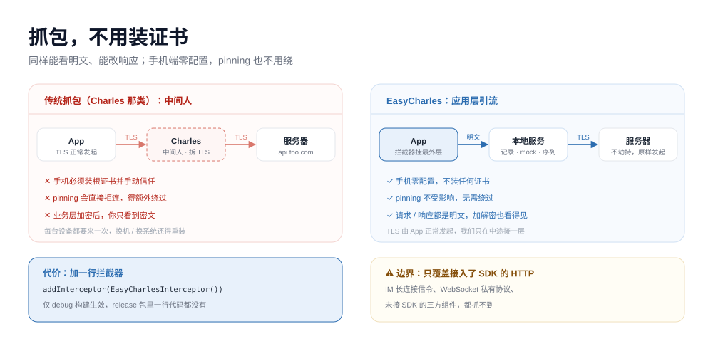
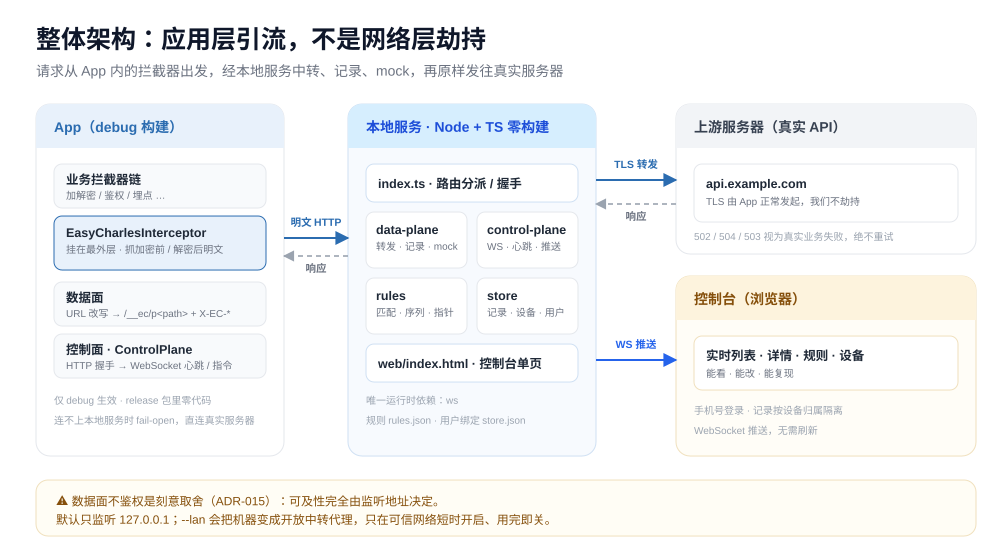
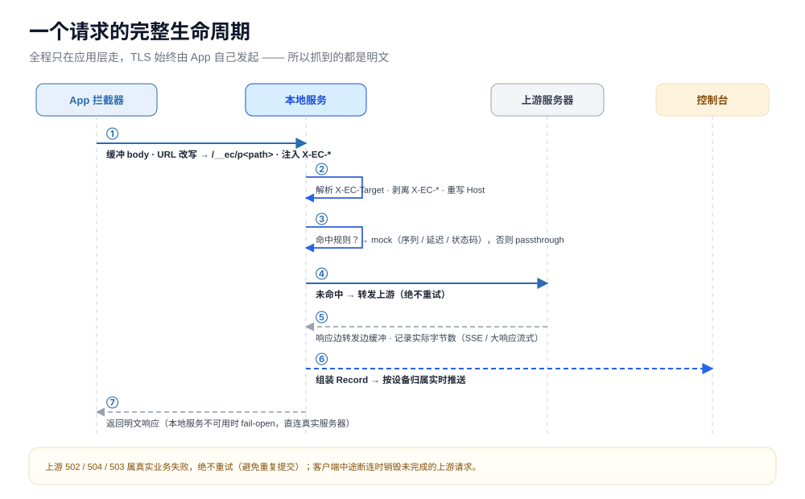
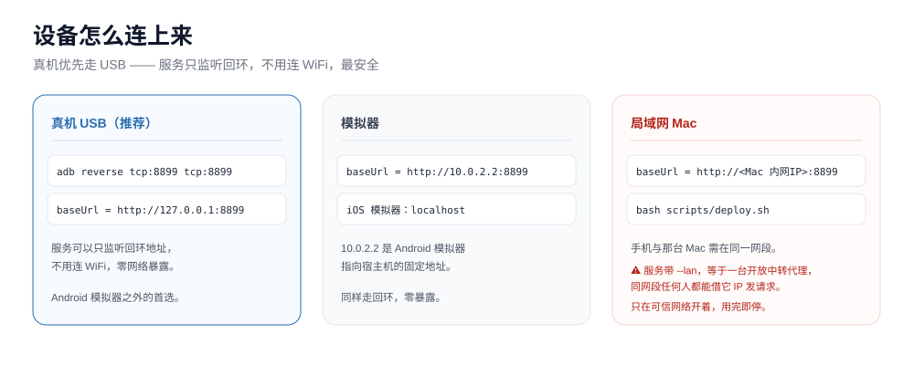

# EasyCharles 使用说明（详细版）

> README 是 5 分钟版；这一份是完整版：**怎么部署、怎么接、面板每个区域是什么、六条能力逐条怎么用**。
> 只想赶紧跑起来 → [README](../README.md)。

**客户端接口联调工具。不用装证书，Mock 不用等后端，调好的场景能沉淀成模板给团队用。**



它不劫持 TLS。你在 App 里挂一个**只在 debug 构建生效**的拦截器，请求发往 EasyCharles，
由它转发到真实服务器，顺路把明文记下来。所以手机不用装根证书，也不受证书绑定（pinning）影响。



代价是**要接一个 SDK**（见第 3 节）。换来的是：手机零配置、pinning 不用绕、业务加密也能看到明文，
并且 mock 规则可以按入参精确命中。

## 目录

1. [它是什么](#1-它是什么)
2. [部署](#2-部署)
3. [接入 Android](#3-接入-android)
4. [手机怎么连](#4-手机怎么连)
5. [操作面板](#5-操作面板)
6. [逐条详解](#6-逐条详解)
7. [它不是什么](#7-它不是什么)
8. [安全](#8-安全)
9. [排错](#9-排错)

---

## 1. 它是什么

一条请求的生命周期可以这么理解：



1. App 的 OkHttp 拦截器把 URL 改成 `http://<服务端>/__ec/p<原 path>`，并带上 `X-EC-Target` 等头；
2. 服务端先看**有没有命中的 mock 规则**：命中就直接回，不打扰真实服务器；
3. 没命中就转发到真实服务器，拿回响应再回给 App；
4. 两个方向都过一遍**加解密配置**：记录里存明文，转发出去的仍是原来的密文；
5. 记录进内存环形缓冲，通过 WebSocket 推到控制台。

三块面板（控制面）、数据面、规则引擎的分层见 [architecture.md](architecture.md)。

---

## 2. 部署

### 2.1 两种形态，别混

| 形态 | 跑在哪 | 启动方式 | 监听 | 用途 |
| --- | --- | --- | --- | --- |
| **本机开发预览** | 你的开发机 | `cd server && npm start` | `127.0.0.1:8899` | 改代码时自己看一眼，手机连不上 |
| **局域网常驻（正式用法）** | 局域网那台常驻 Mac / 内网服务器 | `bash scripts/deploy.sh` | `0.0.0.0:8899` + 口令 | 小组共用，手机走 WiFi 直连 |

本机只负责开发和构建，服务只跑在常驻那台机器上——这样手机 `baseUrl` 不用跟着人变。

### 2.2 前置条件

| 项 | 要求 |
| --- | --- |
| Node.js | **22.6+（推荐 23.6+）**。服务端直接跑 `.ts`，靠 Node 原生类型剥离，无构建步骤 |
| 依赖 | 运行时只有 `ws`，发布包已带上，目标机**不需要 npm install**，也不需要外网 |
| 免密 ssh | `ssh <目标> true` 能直接过去（脚本用了 `BatchMode=yes`，弹密码框会直接失败） |
| 网络 | 目标机与手机同网段；目标机 IP 固定（路由器 DHCP 保留） |

### 2.3 一条命令部署

```bash
cp scripts/deploy.conf.example scripts/deploy.conf   # 只在第一次
bash scripts/deploy.sh
```

`scripts/deploy.sh` 做完这五件事：

1. **门禁**：工作区必须干净（远端跑的版本要能对上 commit）；跑一遍隐私 pre-commit；
2. **打包**：按白名单出 tar.gz + sha256（不含 `.data/`、密钥档、插件目录）；
3. **推送**：scp 到目标机，校验 sha256；
4. **切换**：解包到新的版本目录 → 改软链 → 重启 launchd / systemd；
5. **验收**：首页 200、无会话的管理面必须 401、本次启动没有新增报错行，三条都过才算成功。

`scripts/deploy.conf`（不进 git）只有目标机信息：

| 项 | 含义 |
| --- | --- |
| `EC_DEPLOY_TARGET` | ssh 目标，`user@192.168.x.x` 或 mDNS 名 |
| `EC_DEPLOY_DIR` | 远端放版本目录的基础目录，默认 `~/apps` |
| `EC_DEPLOY_KEEP` | 保留几个旧版本用于回滚，默认 3 |
| `EC_DEPLOY_PORT` | 验收探测端口，默认 8899 |

> 口令**不要写进 deploy.conf**，它在远端的 `~/apps/easy-charles.env`（或 Linux 的
> `/etc/easy-charles/easy-charles.env`）里。

### 2.4 日常运维

```bash
bash scripts/deploy.sh status     # 远端在跑哪版、什么参数
bash scripts/deploy.sh logs       # 看远端启动日志与报错
bash scripts/deploy.sh rollback   # 回上一个版本（rollback 2 = 上上个），不重新构建
bash scripts/deploy.sh check      # 只体检：本机能不能出包 + 远端跑的是哪版，不动任何东西
bash scripts/deploy.sh --dry-run  # 走一遍门禁，打印计划，不碰远端
```

`--allow-dirty` 允许脏工作区出包（只在自己排障时用，版本号会和 commit 对不上）；
`--keep N` 覆盖保留份数；`--target <ssh>` 临时换目标机。

### 2.5 部署完验收

1. 浏览器打开 `http://<内网 IP>:8899`，手机号 + 口令登录（首次登录即注册）；
2. 手机装好 debug 包，控制台应该出现这台设备，浏览模式开始滚记录；
3. 需要管理员视图就配 `EC_ADMIN=<手机号>`，再打开 `/admin`。

### 2.6 服务端参数

`run.sh` 把环境变量翻成命令行参数，优先级：**命令行 > `EC_*` > `EC_ARGS` > 默认值**。

| 环境变量 | 对应参数 | 说明 |
| --- | --- | --- |
| `EC_PASSWORD` | `--password` | 控制台登录口令，**默认 `123456`，暴露到内网前必须改** |
| `EC_ADMIN` | `--admin` | 管理员手机号白名单，逗号分隔；不配 = 没有管理员 |
| `EC_PORT` | `--port` | 端口，默认 8899 |
| `EC_HOST` | `--host` | 监听地址；`EC_LAN=1` 等价 `--lan` |
| `EC_DATA_DIR` | `--data-dir` | 数据目录（绝对路径），默认 `<解包目录>/data` |
| `EC_NODE_BIN` | — | 指定 node 可执行文件，留空用 PATH 里的 |
| `EC_ARGS` | — | 其他 flag 的透传通道，如 `--max-records 5000 --record-mode sample` |

常用 flag 还有：`--snapshot-ttl`（快照有效期，默认 168 小时 = 7 天）、`--max-records`（默认 2000）、
`--upstream-timeout`（默认 30s）、`--no-crypto`（关掉加解密，保存配置也不生效）。

### 2.7 数据目录

| 平台 | 数据目录 |
| --- | --- |
| macOS（launchd 起的服务） | `~/Library/Application Support/EasyCharles/data`（安装脚本的默认值） |
| Linux（按 DEPLOY.md 配的 unit） | `/var/lib/easycharles` |
| 直接跑 `run.sh` / `npm start` | 解包目录下的 `data/`（想固定就用 `EC_DATA_DIR`） |

> 数据目录与服务代码分开，是为了**升级换版本时数据不跟着换**。默认值已经分开了
> （launchd 的 plist 里写死绝对路径），自己起服务时记得配 `EC_DATA_DIR`，否则数据会落在版本目录里。

里面是：`rules.json`（规则）、`store.json`（项目 / 设备 / 用户）、`snapshots/`（快照）、
`crypto/settings.json`（密钥档与路由）、`crypto/scripts/`（脚本插件）、`plugins/`（目录插件）。

**要备份就备份这个目录**，代码目录可以随便换版本。反过来：这个目录含密钥与真实数据，
**不要提交、不要打进发布包**。

### 2.8 不走 deploy.sh 的手动部署

要装 systemd / launchd、要改运行用户、要在目标机离线安装，看
[scripts/deploy/DEPLOY.md](../scripts/deploy/DEPLOY.md)——那里是发布包随附的部署依据，
含 unit 文件写法、目录权限、健康检查与卸载步骤。

---

## 3. 接入 Android

**1. 引入模块**（`app/build.gradle.kts`）：

```kotlin
dependencies {
    debugImplementation(project(":easy-charles"))   // 只在 debug 构建，release 包里没有
    implementation("com.squareup.okhttp3:okhttp:4.12.0")
}
```

**2. 允许明文（仅 debug）**：Android 9+ 默认禁明文。放一份
`app/src/debug/res/xml/network_security_config.xml`：

```xml
<?xml version="1.0" encoding="utf-8"?>
<network-security-config>
    <base-config cleartextTrafficPermitted="true" />
</network-security-config>
```

在 `app/src/debug/AndroidManifest.xml` 里引用它：

```xml
<manifest xmlns:android="http://schemas.android.com/apk/res/android">
    <application android:networkSecurityConfig="@xml/network_security_config" />
</manifest>
```

只加在 debug sourceSet，release 合并时不会带上。

**3. 初始化**（`Application.onCreate`）：

```kotlin
EasyCharles.init(
    this,
    EasyCharles.Config(
        baseUrl = "http://192.168.x.x:8899",  // 服务端地址；模拟器用 http://10.0.2.2:8899
        reportUserName = false,               // userName 属个人信息，默认不上报
        env = "test",
    ),
)
```

**4. 挂拦截器（顺序是关键）**：

```kotlin
val client = OkHttpClient.Builder()
    .addInterceptor(EasyCharlesInterceptor())  // ← 必须放在最外层
    .addInterceptor(yourCryptoInterceptor)     // ← 业务自己的加解密拦截器
    .build()
```

`addInterceptor` 先加的更靠外。捕获拦截器在最外层，才能看到加密前的请求、解密后的响应；
放反了只能看到密文。

**5. 打个业务标签**（登录成功后调，控制台设备标签实时刷新）：

```kotlin
EasyCharles.setUser(userId = "10086", userName = "张三")
EasyCharles.setEnv("test")
EasyCharles.setTags(listOf("IM", "支付"))
```

**release 里为什么一定是空的**：`debugImplementation` 不进 release 依赖 → `BuildConfig.DEBUG`
为 false → 运行时再校验 `FLAG_DEBUGGABLE`，非 debuggable 进程全部 no-op。三重保险缺一不可。

**SDK 是 fail-open 的**：连不上本地服务就直连真实服务器，业务无感知；连续失败 3 次熔断，
冷却后半开探测。所以服务端挂了不会让 App 也挂。

---

## 4. 手机怎么连



| 方式 | 做法 | 说明 |
| --- | --- | --- |
| **真机 WiFi（标准用法）** | `baseUrl = http://<那台 Mac 的内网IP>:8899` | 手机与服务端同一个 Wi-Fi；数据面不鉴权，见第 8 节 |
| 模拟器（本机开发） | `baseUrl = http://10.0.2.2:8899` | 只在本机 `npm start` 时用 |
| 真机 USB（本机开发） | `adb reverse tcp:8899 tcp:8899`，`baseUrl = http://127.0.0.1:8899` | 仅当服务跑在**插着手机的那台机器**上 |

两个坑：

- **别拿 `adb reverse` 连局域网那台 Mac**：它只对 USB 连着的这台机器生效，到不了另一台机器；
- **地址要固定**：IP 一变，所有调试包都得重打（路由器里给那台 Mac 做 DHCP 保留）。

---

## 5. 操作面板

### 5.1 登录与顶栏

打开 `http://<内网 IP>:8899` → 手机号 + 口令。**首次登录即注册**，之后这个手机号就是一个独立空间：
自己的记录、自己的私有项目，别人看不到（设备绑定后生效，一个空间同时绑一台设备）。

顶栏从左到右：模式切换（浏览 / Mock / 模板）、设备选择器（点未绑定的设备即绑定）、
连接状态点、当前空间、关于、退出。断线会自动重连，状态点变灰就是 WebSocket 断了。

### 5.2 浏览模式

左边是记录列表，右边是详情。

- **搜索框**：按 URL 片段或状态码过滤，实时生效；
- **清空列表**：只清当前空间（受设备筛选与搜索影响），不动规则、不动项目；
- **列表每行**：方法、状态码、路径、耗时，以及 `mock` / `解密` / `流式` 三种标签；
  行内不放按钮，动作统一收在右边详情里，列表保持纯浏览；
- **详情**：状态码、总耗时与上游耗时、query 参数表（哪些参与匹配、哪些被折叠）、
  请求头 / 响应头、请求 body、响应 body；
- **body 查看**：层级树与 JSON 文本两种视图，可格式化、可放大（带 minimap）、可一键复制；
- **底部动作**：「Mock 此接口」（接口已 mock 时置灰）、「分享快照」、「复制为 cURL」。

记录在内存环形缓冲里（默认 2000 条），**重启服务就丢**；要留存就存进项目或分享成快照。

### 5.3 Mock 模式

三段式：上面项目卡片栏、左边接口列表、右边返回值编辑器。

**项目卡片栏**只列最近选过的项目：`全部` + 最近用过的几个 + `更多 N`（点开就地展开）+ `+` 新建。
选过的项目记在浏览器本地，刷新不丢。卡片上行点一下切项目；下行是**整组开关**与**删除**。

- 整组关掉：项目内规则一条都不命中，但规则本身不掉，重新打开即恢复（不改写每条规则的开关）；
- 停用后这张卡立刻从栏里消失（留着灰卡只会误导），要重新启用去「模板」模式，启用后自己回到栏里；
- 开关和删除都会先弹确认框。

**接口列表**：每个接口一行，带命中方式与返回值条数。顶部「重置指针」把所有「按顺序」规则的进度
归零（只影响自己的私有规则）。

**返回值编辑器**：

| 区域 | 能改什么 |
| --- | --- |
| 基本 | 启用开关、方法 / host / path、命中方式 |
| 入参 | 参与匹配的参数勾选（默认折叠时间戳、签名这类每次都在变的公共参数） |
| 返回值列表 | 增删、排序、每条的状态码 / Content-Type / 正文 / 备注；指定某一条时点左侧圆点 |
| 顺序去向 | 走完停在最后一条 / 循环 / 放行到真实服务器 |
| 动作 | 保存并生效、复制为 cURL、追加真实响应（把当前这条记录的真实响应再补一条） |

命中方式、启停这类改动**立即生效**；改正文后要点一次「保存并生效」。

### 5.4 模板模式

私有项目 / 共享项目两个 tab，网格卡片排布，网格最后一项是「+」（新建私有项目）。

卡上直接带：分享、复制到我的项目、历史版本、归档、删除 / 恢复。共享项目卡上是「删除」/「恢复」
（7 天冷静期，见 6.4）。点开一个共享项目，下半部分就是「当前内容（只读）」和「历史版本」列表，
可以预览某一版、可以「回退到这里」。

### 5.5 两个独立页面

- **`/crypto` 加解密配置**：密钥档（算法 / Key / IV / 密文位置）+ 解密路由（按 method/path 匹配）
  + 脚本插件（只读展示源码，参数可填）+ 试跑框。字段详解见 [crypto.md](crypto.md)；
- **`/admin` 管理员视图**：只有启动时配了 `--admin` 才有内容，含实例统计与配置总览（ADR-018）。
  页面是静态壳，数据全走 `/__ec/api/admin/*`，服务端校 `role=admin`。

### 5.6 分享出去的快照

详情页点「分享快照」→ 生成 `http://<内网 IP>:8899/s/<id>` 的免登录只读链接，
同事打开就能看到这条请求的全部内容（默认 7 天过期，`--snapshot-ttl` 可改）。
链接本身就是凭据，**只在可信范围转发**。

### 5.7 一次典型调试

1. 手机发一条请求 → 浏览模式点开，对参数、看响应；
2. 点「Mock 此接口」→ 规则当场建好并生效（返回值 = 刚才那条真实响应）；
3. 进 Mock 模式，加一条 401、选「按顺序」→ 手机重新进页面，先成功再失败；
4. 调好了点「分享为共享项目」→ 同事在模板模式「复制到我的项目」直接拿去用。

---

## 6. 逐条详解

### 6.1 抓包：手机不用装证书

一句话：这里没有中间人——请求还是 App 自己发出来的，只是换了个目的地，所以不用装根证书、
不用改代理、不用绕证书绑定。


**原理**：拦截器把请求改道到 EasyCharles，服务端转发到真实服务器并记录。全程不进 TLS 隧道，
所以不用装根证书、不用改代理、不受 pinning 影响。

**能看到什么**：状态码、总耗时、上游耗时、业务参数、请求头 / 响应头、完整 body、
请求与响应的字节数；一条记录能直接「复制为 cURL」复现。

**为什么不需要证书**：证书是给「网络层中间人」用的。这里没有中间人——请求本来就由 App 自己发出来，
只是换了个目的地。

**限制**：抓不到非 HTTP 的私有协议（IM 长连接、WebSocket 私有信令）；HttpURLConnection / 其他
网络库要么换成 OkHttp，要么等对应 SDK。

**流式响应**：SSE / 大响应边转发边记录，不阻塞；超大 body 落盘、只读一次再转发。

### 6.2 改返回值：一个接口可以配好几条

一句话：每条返回值独立设置状态码和正文，所以「成功 / token 过期 / 风控拦截」这种链路
配三条就能一趟走完——改完立即生效，不用等后端发版。


**建规则最快的路**：浏览模式选中一条真实请求 →「Mock 此接口」。规则**当场建好并落库**，
返回值就是刚才那条真实响应，之后这个接口再被请求就直接回你的值，不再打真实服务器。

**匹配**默认是「域名 + 路径 + 入参」三者都对上：

- `timestamp` / `sign` / 设备号这类每次都在变的公共参数**默认折叠**，不写进匹配条件，
  不会因为签名变了就命中不了；可以在入参区手动勾回来；
- `path` / `host` 支持 glob（`*`）和 `re:` 正则；
- 同一接口有多条规则同时启用时**只命中一条**，按 `priority` 取大的（控制台可改，默认 10）。
  所以别让两条同接口的规则同时开着，第二条是纯噪音。

**命中方式三选一**：

| 命中方式 | 适合什么 |
| --- | --- |
| 指定某一条 | 反复调同一个分支，不想被序列带跑 |
| 按顺序 | 依次返回，走完**停在最后一条** / **循环**（默认）/ **放行到真实服务器** |
| 随机 | 压测客户端对各种返回的容错 |

每条返回值能单独设**状态码**和**正文**，所以「错误」就是普通的一条：

```
第 1 条  200  {"code":0,"token":"..."}       登录成功
第 2 条  401  {"code":1001,"msg":"密码错误"}  密码错误
第 3 条  403  {"code":403,"msg":"风控拦截"}   风控拦截
```

三条循环返回，客户端「正常 → token 过期 → 风控」的分支一趟就能走完，不用等后端真的把你封了。

**顺序指针**按 `(设备, 规则)` 隔离——两台手机各走各的进度，互不干扰；同一台手机换会话不会重置，
要重来点「重置指针」（只影响自己私有规则）。删掉返回值条目后指针可能越界，
「停在最后一条」会自动夹回末条，想从头走就重置。

**延迟**：写在规则里（`action.delayMs`，CLI 是 `--delay-ms`），控制台不提供编辑项。

### 6.3 加密接口也能看

一句话：配一次密钥档与路由，控制台显示**解密后的明文**，随时能切回密文原文；
mock 时 body 填明文，命中规则自动加密回写。


业务把请求体加密、响应体加密回来，普通抓包工具只能看到一串密文。两条路都能走：

| 路径 | 做法 | 适用于 |
| --- | --- | --- |
| **A. 服务端解密（推荐）** | 在 `/crypto` 配密钥档与路由，EasyCharles 自己解 | 所有情况，含加解密写在 Converter / 请求构造里 |
| B. 拦截器顺序 | 把拦截器挂在业务加解密拦截器的**外层** | 加解密确实在拦截器里，且不想配密钥 |

**路径 A：配一次，之后都看明文**（ADR-039 / ADR-040）

1. 打开 `/crypto`，新建一个**密钥档**：算法（AES / 3DES / SM4 / GCM / ChaCha20-Poly1305）、
   Key（支持 utf8 / base64 / base64url / hex）、IV、密文编码；
2. 新建一条**解密路由**：方法 + host + path（支持 glob / `re:`），选上面那个密钥档，
   勾「解请求」「解响应」。路由**按顺序匹配、第一条命中生效**，所以条件写窄一点
   （`*signature*` 这种，别用裸 `*`——那会把所有接口都送去解密）；
   GET 的 query 密文不在这里配，它在密钥档里的 `query` 那一栏；
3. 用页面上的试跑框粘一段密文验证——解不开会直接告诉你原因（密钥不对 / 不是合法 base64 /
   解出来不是 UTF-8）；
4. 请求一次，详情里就是明文，标着「已解密」，响应体上可以随时切「查看密文」。

**密文在哪**要配清楚，这是最容易配错的一步：

| 位置 | 配置 |
| --- | --- |
| body 本身就是密文 | `raw`，可带前缀（如 `ciphertext:`） |
| 密文在 JSON 的某个字段 | `json` + 字段名 |
| 表单字段 | `form` + 字段名 |
| GET 的 query 参数 | `query.field`，同样支持前缀 |

**AEAD（GCM / ChaCha20-Poly1305）**不配 IV，改配布局：`ivBytes`（一般 12）、`tagBytes`（一般 16）、
`tagAt`（`end` / `start`），只支持 `iv|ciphertext|tag` 和 `iv|tag|ciphertext` 两种排列。

**mock 加密接口**：body 填**明文**就行，命中规则后由同一个密钥档加密回写，App 照常解密。
所以「配好解密」和「mock 能回写」是同一件事的两面，天然成对。

**路径 B：靠拦截器顺序，不用解**

```kotlin
OkHttpClient.Builder()
    .addInterceptor(EasyCharlesInterceptor())  // 外层：拿到明文
    .addInterceptor(yourCryptoInterceptor)     // 内层：业务加解密
    .build()
```

请求方向在加密之前取 body，看到明文；响应方向业务先解密再往外传，看到的也是明文。
加解密写在 Converter 里时这条路就不成立——用路径 A。

**安全边界**：

- 密钥只存 `<数据目录>/crypto/settings.json`，**不进 git、不进发布包**；
- 规则里只存 `profileId`，不存 Key——规则会被分享、导出、截图，混进密钥等于「分享一套 mock = 泄露线上密钥」；
- 页面回显的 Key / IV 一律打码，留空保存 = 沿用原值；
- 解密**只改记录、不改转发**：线上发出的仍是原来的密文，解不开只影响展示，不影响接口；
- 自定义脚本插件要放 `<数据目录>/crypto/scripts/<名字>.mjs`，**本机手工放**，控制台只读不写
  （能写 .mjs = 持 token 即可执行任意代码）。

**已知限制**：脚本插件目前同步执行，不支持在脚本里做异步 IO；worker 隔离还没做，
插件里的同步死循环会卡住转发。详见 [crypto.md](crypto.md) 与 [crypto-plugin.md](crypto-plugin.md)。

### 6.4 项目与模板：调好的这套沉淀下来

一句话：一组接口配置就是一个「项目」，可以整组启停、分享成团队模板让人复制，
每次改动都留历史版本，改坏了能一键回退。


一组规则 = 一个**项目**。比如「登录模块」5 个接口、每个 3 条返回值，配好一次就能整组分享。

- **私有项目**：自己的，参与命中，可整组启停、重命名、删除（删了就没了，连带删掉里面的规则，
  没有回收站；确认框里会写清楚连带条数）；
- **共享项目**：本实例所有登录用户可读的**只读模板**，永不直接命中——要用先「复制到我的项目」。
  这样别人改共享库不会突然改变你手机上的行为；
- **分享回同一个共享项目 = 整项目覆盖**，不是增量合并，提交前会告诉你有几条会增、几条会删；
- **删除共享项目是「先挂 7 天」**：进入待删除状态（列表标「剩 N 天」），规则与历史版本一条没动，
  点「恢复」就回来；7 天没人恢复才真正删掉；
- **归档**：从常用列表里收起来，快照与历史一条不动，仍可回退。

共享前请自查：共享项目和它的全部历史，本实例所有登录用户都读得到，里面可能有 token、cookie、
真实用户数据。

### 6.5 接口返回值按版本存档

一句话：每次分享或回退都追加一条**不可变快照**，里面是当时全部接口和返回值的完整一份；
重构前存一次，重构后拿它对照或回退。


每次分享、每次回退都会追加一条**不可变版本**，里面是当时全部接口和返回值的完整快照。

- 可以预览某一版，可以「回退到这里」；**回退是追加一条新记录，不是撤销**，旧版本一条不删；
- 抓到的真实响应可以一键存进项目（「Mock 此接口」），线上数据直接沉淀成资产；
- 重构前把当前这套分享一次存下来，重构后拿它对照或回退，造过的数据不用再造一遍。

> 现状：版本快照只覆盖**共享项目**，版本号是服务端 id。人类可读的 V1.0 / V1.1、私有项目版本、
> 版本间接口列表对比还没做，排期见 [roadmap.md 的 P8](roadmap.md)。

### 6.6 接进 AI 工作流

一句话：`mock` 命令行有 `--json` 结构化输出、退出码即契约，agent 能自己把一句话拆成几条
写操作，写完读回核对再报结果。


`mock` 命令行走管理面，可以打远程实例；给 agent 的契约是：`--json` 出结构化结果、
退出码表示成败、写操作一律读回核对。

```bash
cd server
node tools/mock-cli/mock.ts api create --path /api/order/list \
  --param page=1 --json-list '{"code":0,"data":{"list":[{"id":1}],"hasMore":true}}' --json
node tools/mock-cli/mock.ts api create --path /api/order/list \
  --param page=2 --json-list '{"code":0,"data":{"list":[{"id":2}],"hasMore":true}}' --json
node tools/mock-cli/mock.ts api create --path /api/order/list \
  --param page=3 --json-list '{"code":0,"data":{"list":[],"hasMore":false}}' --json
```

在 Codex / Claude Code 里只需要说一句：

> 帮我给 `/api/order/list` 造一组翻页数据，三页，每页 20 条，最后一页没有更多。

agent 自己拆成几条 `mock api create`（每页一条、带 `--param page=N`），写完读回核对再报结果。
口令从 stdin 传，不落配置文件；共享项目不直接命中，要先复制成私有项目。

完整命令、退出码与约定见 [mock-cli.md](mock-cli.md)。

---

## 7. 它不是什么

- **不是 Charles 的完整替代**：不劫持 TLS、不装证书，所以也抓不到非 HTTP 私有协议
  （IM 长连接、WebSocket 私有信令）
- **不是零配置工具**：要接一个 SDK，但只在 debug 生效
- **不是抓包历史管理器**：记录在内存环形缓冲里（默认 2000 条），**重启服务就丢**
- **不是生产环境工具**：`--lan` 只在可信网络短时开启

## 8. 安全

- **默认只监听回环**，配 `adb reverse` 或模拟器时手机之外零暴露
- **数据面按设计不鉴权**（ADR-015，为了 `adb reverse` 零暴露）。`--lan` 会让同网段任何人
  都能借你的机器发请求，**用完即关**
- **release 三重保险**：`debugImplementation` + `BuildConfig.DEBUG` + 运行时校验
  `FLAG_DEBUGGABLE`，非 debuggable 进程全部 no-op
- **SDK fail-open**：连不上服务就直连真实服务器；连续失败 3 次熔断，冷却后半开探测
- **不重试上游失败**：502/504/503 是真实业务失败，重试可能造成重复提交
- **快照链接即凭据**：免登录可读，内容含完整请求头（可能有 token / cookie），只在可信范围转发
- **口令默认 `123456`，共享网络下必须改**（`EC_PASSWORD`）
- 仓库里不含任何密钥与真实数据：密钥档、规则、快照都在数据目录，已被 `.gitignore` 与发布
  白名单排除

## 9. 排错

| 现象 | 先看什么 |
| --- | --- |
| 手机上没记录 | 控制台右上连接状态点是否亮；设备选择器里有没有这台设备；`baseUrl` 是否可达（手机浏览器打开 `http://<IP>:8899`） |
| 服务端连不上 | `bash scripts/deploy.sh status` / `logs`；本机开发看终端有没有报错；端口被占 |
| 加密接口还是密文 | `/crypto` 里路由的 method / path 是否对得上；wrap 位置（raw / json / form / query）选对没；试跑框能不能解开 |
| mock 不命中 | 入参里是不是有每次都变的参数没折叠；path 的 glob 写对没；规则开关、项目整组开关是否都开着；规则是否排在别的规则后面 |
| 顺序返回值不按预期走 | 指针按 (设备, 规则) 隔离，换台手机就是新指针；同一台手机换会话不重置；点「重置指针」归零 |
| Android 9+ 请求直接失败 | debug sourceSet 的 `network_security_config.xml` 没加，或没在 debug manifest 里引用 |

更多：协议字段看 [protocol.md](protocol.md)，加解密排错看 [crypto.md](crypto.md) 第 7 节，
局域网多人协作看 [lan-workflow.md](lan-workflow.md)。

**当前状态**：抓包、Mock（多条 / 顺序 / 循环 / 错误）、模板与分享、快照、多设备多用户、
服务端加解密与插件都已可用；记录落盘、HAR 导入导出、worker 隔离还没做；iOS SDK 在计划中。
